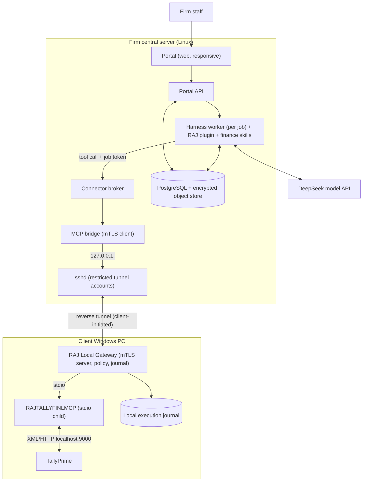

# RAJ Finance Agent — Implementation Plan

Status clarified: 2026-11-03. This document preserves the original target design and proposed milestones. Its diagrams and proposed paths are not an inventory of implemented components.

For the current runtime and complete user workflow, read [WORKFLOW.md](WORKFLOW.md). For the agreed next five delivery steps and acceptance gates, read [ROADMAP.md](ROADMAP.md).

The current implementation uses a custom Python harness, SQLite, custom REST Gateway and its own Tally XML adapter. RAJTALLYFINLMCP, the separate DeepSeek Harness, PostgreSQL and the proposed stdio MCP bridge are not integrated into the current runtime. Existing fake-Tally tests do not establish those integrations.

Review baseline: the original 27 tests passed; additional regressions and Windows packaging/SSH configuration defects remain open as recorded in the roadmap. Real TallyPrime, actual sshd transport and Windows service/reboot validation remain release gates. References below to “M0–M4” or planned security mechanisms are requirements to verify, not completion claims.

---

## સારાંશ (Gujarati summary)

- System બે ભાગમાં: **Client Windows PC** (RAJ Local Gateway + RAJTALLYFINLMCP + Tally + Execution Journal) અને **Firm central server** (Portal, DeepSeek Harness + finance skills, MCP Bridge, OpenSSH server, PostgreSQL).
- Client PC જાતે outbound SSH connection બનાવે છે; server agent એ tunnel દ્વારા માત્ર local Gateway સુધી પહોંચે છે — Tally port 9000, RDP કે shell નહીં.
- અલગ Finance Workflow service નહીં: skills Harnessમાં, durable job state RAJ Harness pluginમાં, permissions અને posting checks Gateway/MCP codeમાં.
- **પહેલું milestone (M1):** Portalમાં Client પસંદ કરો → પ્રશ્ન → Harness tool → SSH → MCP Tally વાંચે → verified report. માત્ર read-only.
- પછી M2: bank CSV/XLSX reconciliation અને drafts; M3: signed approval, local journal, posting, read-back અને recovery; M4: installer, pilot; M5: CMA decision support.
- DeepSeek Super-agent ફક્ત development repo અને synthetic fixtures પર કામ કરશે; production Tally કે live books સુધી પહોંચ નહીં.

---

## 1. Target architecture (planned integrations)



Trust rules that the code must enforce (not the model):

| Layer | Enforces | Failure mode |
|---|---|---|
| Portal API | user ↔ client assignment, role | 403, no job created |
| Harness worker | tool allow-list per job type (read vs write) | tool not registered in session |
| Broker | job token → exactly one connector; worker has no other route | refuse, audit |
| sshd | per-device key, `PermitListen` single port, no PTY/shell/SFTP | connection refused |
| Gateway | mTLS identity, execution envelope signature, expiry, nonce, company binding | reject before MCP call |
| MCP | voucher schema, ledger existence, balance, permission ceiling | reject, no Tally call |
| Read-back | what Tally actually stored | `RESULT_UNKNOWN` / manual review |

## 2. Repository layout

```
apps/
  portal/              # web UI
  api/                 # portal API: users, clients, devices, jobs, approvals, artifacts
  windows-connector/   # gateway service, tray app, ssh supervisor, installer
packages/
  contracts/           # JSON Schemas (source of truth) + generated TS/Python types
  harness-raj/         # Harness plugin: durable jobs, checkpoints, tool registration, skills
  mcp-bridge/          # server-side stdio<->mTLS MCP bridge used by workers
  broker/              # connector registry + job-token routing
  calculations/        # deterministic Decimal finance calcs (ageing, TB checks, matching)
infra/
  ssh/                 # sshd_config fragments, account provisioning scripts
  deploy/              # compose/systemd, backups, monitoring
tests/
  fixtures/            # synthetic Tally XML responses, anonymized bank files
  e2e/                 # full path: portal -> worker -> bridge -> tunnel -> gateway -> fake Tally
docs/
  PRODUCT_PLAN.md
  IMPLEMENTATION_PLAN.md
  runbooks/
```

RAJTALLYFINLMCP stays in its own repo and is consumed as a pinned version (wheel built from a tagged commit), not copied.

### Language choices (proposed)

- **Gateway + Windows connector:** Python, same runtime as RAJTALLYFINLMCP, packaged as one signed bundle (e.g. PyInstaller/embedded Python) running as a Windows service. Tray app can be a thin separate process talking to the service over a local named pipe.
- **Harness plugin (`harness-raj`) and MCP bridge:** whatever language the pinned Harness plugin API uses (**VERIFY**; the Super-agent prototype ships a `package.json`, suggesting TypeScript/Node).
- **Portal API:** choose one of Python (FastAPI) or TypeScript after the Harness check — prefer the same language as `harness-raj` so job/approval code is shared.
- **Contracts:** JSON Schema in `packages/contracts`, types generated for both languages; canonical JSON (RFC 8785 JCS) for anything that is hashed or signed.

## 3. Core contracts (define in M0, used from M1)

### 3.1 Job

```
job_id (uuidv7), org_id, client_id, company_binding_id, device_id,
type: read_report | reconcile | post_vouchers,
state: RECEIVED | VALIDATED | WAITING_FOR_DEVICE | READING | DRAFTED |
       WAITING_FOR_APPROVAL | POSTING | VERIFYING | COMPLETED |
       REJECTED | CANCELLED_BEFORE_POSTING | PARTIALLY_COMPLETED |
       RESULT_UNKNOWN | FAILED,
initiated_by, created_at, expires_at,
versions: {harness, plugin, skills, model, mcp, gateway}
```

Every transition is a row in `job_events` written **before** the external effect it announces.

### 3.2 Job token (server → broker → gateway, every call)

Short-lived (≤ 5 min, renewable by the worker's supervisor, not by the model), Ed25519-signed by the server:

```
{ job_id, org_id, client_id, device_id, company_guid,
  capability: "read" | "write", allowed_tools: [...],
  period: {from, to}, iat, exp, nonce }
```

### 3.3 Execution envelope (writes only)

```
{ job_id, approval_id, draft_id, draft_version,
  payload_sha256,                # JCS-canonical voucher payload
  company_guid, operation: "create_voucher",
  reviewer_id, iat, exp, nonce (single use) }
```

Gateway recomputes `payload_sha256` from the exact payload it is asked to post. Any mismatch, expiry, reused nonce or company change → reject.

### 3.4 Company binding

Bound at pairing: Tally company GUID + name + books-from date. Gateway checks the currently open company against this binding before **every** call, and again immediately before each mutation.

## 4. Milestones

Estimates assume a small team with a real Tally test PC; calendar gates (two monthly cycles) can extend them.

### M0 — Foundations (week 1–2)

1. Pin versions: Harness commit + lockfile, RAJTALLYFINLMCP tag, OpenSSH server version, TallyPrime release. Record in `docs/compat-matrix.md`.
2. Run RAJTALLYFINLMCP's own tests; run representative reads against a live TallyPrime test company (TB, ledger, outstanding). Log every gap.
3. **VERIFY** Harness: plugin API, how MCP servers are configured per session (stdio vs Streamable HTTP), whether tools can be filtered per session, how checkpoints/state are exposed.
4. Write JSON Schemas for §3, generate types, add CI (lint, typecheck, unit tests).
5. Threat model doc (`docs/threat-model.md`) covering the table in §1.

Exit: live Tally reads verified; Harness integration path chosen; contracts merged.

### M1 — First working build: read-only end to end (week 3–5)

Target flow: **Portal → choose client → ask → Harness tool → SSH → MCP reads Tally → verified report.**

Server side:
1. `api`: users, roles (admin/preparer/reviewer only for M1), clients, company bindings, devices, enrollment codes (hash stored, single-use, expiring).
2. `infra/ssh`: one restricted Unix account per device, `authorized_keys` with `restrict,port-forwarding,permitlisten="127.0.0.1:<port>"`; sshd `AllowTcpForwarding remote`, `GatewayPorts no`, `PermitTTY no`, `X11Forwarding no`, `AllowAgentForwarding no`, `ForceCommand /usr/sbin/nologin`, SFTP disabled. Automated test proves shell, SFTP, local forwarding and a second listen port are all refused. (**VERIFY** `MaxSessions 0` behaviour on the pinned version.)
3. `broker`: maps `device_id → loopback port + expected gateway cert fingerprint`; only reachable by workers via a Unix socket; workers run in a network namespace with no route to `127.0.0.1:<tunnel ports>` directly.
4. `mcp-bridge`: presents to Harness as a stdio MCP server; for each call obtains route from broker, opens mTLS to the gateway, pins the device's cert, attaches the job token.
5. `harness-raj` plugin: creates job, writes events, registers **read-only** tools only, renders report with metadata (company, period, extraction time, tie-out status).
6. Skills: `trial_balance`, `ledger_statement`, `receivables_ageing`, `payables_ageing`. Calculations (ageing buckets, totals) run in `packages/calculations` with Decimal; the model only explains results.
7. Portal: login, client picker (shows client + company + period on every screen), Ask the Books, report view, Device Health with four separate statuses.

Client side:
1. Gateway service: mTLS server on `127.0.0.1:<local port>`; verifies job token signature, expiry, device, company; spawns RAJTALLYFINLMCP as a stdio child with **fixed** Tally endpoint and `read_only` ceiling set from gateway config (not from MCP settings).
2. MCP hardening PRs upstream in RAJTALLYFINLMCP: default `read_only`; immutable permission ceiling; remove/disable model-callable settings update; per-request company context instead of process-global switching; hide write/raw-XML/TDL tools when ceiling is read-only.
3. SSH supervisor: Windows OpenSSH client with `-N -R 127.0.0.1:<port>:127.0.0.1:<local port>`, `ServerAliveInterval`, `ExitOnForwardFailure yes`, pinned `known_hosts`, exponential backoff with jitter.
4. Pairing CLI (tray UI can come in M4): redeem code over HTTPS, generate device keys locally (DPAPI-protected), register SSH pubkey + gateway CSR, confirm company.
5. Health reporter: PC online / SSH connected / MCP ready / Tally company ready.

Tests and exit gate:
- e2e test with a fake Tally HTTP server replaying fixtures, through real sshd + gateway + bridge in containers.
- Cross-client denial suite: worker for client A cannot reach B's port, B's cert fails pinning, A's token rejected by B's gateway, model-supplied client IDs ignored.
- Golden tie-out: TB/ledger/ageing on the test company match native Tally output (documented rounding).
- SSH up + Tally closed shows "SSH connected, company not ready" — never a fabricated report.

### M2 — Bank reconciliation and drafts (week 6–8)

1. Upload CSV/XLSX; store source + SHA-256; column detection with explicit user confirmation of date/debit/credit; formulas/macros ignored.
2. Opening/closing balance check; mismatch blocks preparation.
3. Read bank ledger entries for fixed company/period/bank ledger.
4. Deterministic matcher in `calculations`: reference → amount+date window → one-to-many; never amount-only. Every source row gets matched / unmatched / duplicate-source / ambiguous.
5. AI suggests ledger for unmatched rows with evidence; result is a **draft** (`drafts`, `draft_rows`, versioned).
6. Voucher preview UI with exceptions; reviewer can edit → new draft version.

Exit: every source row classified; totals reconcile; no ambiguous match auto-accepted.

### M3 — Controlled writes (week 9–11)

1. Approval service: reviewer approves exact draft version → server signs execution envelope (§3.3) per row or batch; configurable maker/checker and expiry.
2. Gateway write path: verify envelope → persist intent to local journal (SQLite, WAL, `fsync`) → re-check company → call MCP create → record Tally response → read back voucher → compare accounting fields/totals → report.
3. Stable correlation reference written into a supported voucher field (**VERIFY** which field survives in TallyPrime, e.g. narration tag or reference no.).
4. Recovery: on lost response or restart, journal entries in `SENT` without result → search Tally by correlation ref + date + amount; found and matching → `VERIFYING/COMPLETED`; not found or ambiguous → `RESULT_UNKNOWN`, block further writes on that ledger/period until manual reconciliation. Never blind-retry.
5. Writes serialized per connector. Delete/cancel tools disabled.
6. Write capability enabled per device only by admin after test-company validation.

Exit: failure-injection suite (kill ssh/gateway/worker/db before, during, after post; drop Tally response; reboot) shows zero unexplained duplicates and every accepted write has source, approval, journal entry and read-back or explicit unresolved state.

### M4 — Productisation and pilot (week 12–18)

Signed Windows installer + tray app, signed update manifests with staged rollout and rollback, offboarding (revoke keys/certs, kill live sessions, invalidate approvals), diagnostics export with redaction, backups + restore drills, monitoring (per-status device health, queue depth, RESULT_UNKNOWN count, cost per job), Gujarati explanations in portal. Pilot with 3–5 clients for two monthly cycles, then 10–25.

### M5 — Decision support and scale (week 19+)

Cash forecast, budget vs actual, contribution, break-even and pricing scenarios using deterministic calculations with labelled assumptions; measured rollout 50 → 100 → 250 devices.

## 5. DeepSeek Super-agent (development only)

- Works on this repo and RAJTALLYFINLMCP through a bot GitHub identity with branch + PR rights only; no merge, no secrets, no production SSH keys or client data.
- Inputs: approved GitHub issues; fixtures in `tests/fixtures` only.
- Loop: issue → branch → code + tests → CI green → PR → human review → signed build → test client → staged rollout.
- Skill and rule changes to finance workers go through the same PR review; no self-modification of running workers, no widening of permissions.

## 6. First ten tickets (create as GitHub issues)

1. Pin versions and create `docs/compat-matrix.md`.
2. Live Tally read verification report for RAJTALLYFINLMCP.
3. Harness plugin/MCP integration spike (**VERIFY** items in M0.3).
4. `packages/contracts`: job, job token, execution envelope, company binding schemas + codegen.
5. RAJTALLYFINLMCP hardening: read-only default, immutable ceiling, remove settings-update tool, per-request company.
6. `infra/ssh`: restricted tunnel account provisioning + negative tests.
7. Gateway service skeleton: mTLS, token verification, stdio MCP child, health endpoint.
8. Broker + MCP bridge with cert pinning; worker network isolation.
9. `harness-raj` read-only plugin + four report skills + Decimal calculations.
10. Portal M1 screens + e2e test with fake Tally.

## 7. Inputs needed from the firm

- Windows test PC with the exact TallyPrime release and an authorized test company.
- Anonymized bank statements (2–3 banks) and sample vouchers.
- Server + domain, chosen DeepSeek model and API key (via secret manager, never in issues).
- Retention policy, approval roles, maker/checker rule, high-value thresholds.
- Decision on portal/API language after the Harness spike.

## 8. Main risks

| Risk | Mitigation |
|---|---|
| Harness is developer preview; API changes | Pin commit, keep plugin thin, contract tests on upgrade |
| RAJTALLYFINLMCP untested against live Tally | M0 live verification before any feature work |
| No reliable correlation field in Tally vouchers | Spike in M3 step 3; if none, stricter RESULT_UNKNOWN handling |
| Windows session/Tally must be running interactively | Health status + compatibility matrix; no auto-start promise |
| Cross-client leakage via shared loopback | Broker-only routing, worker netns, mTLS pinning, deny tests |
| Data leaves client PC (server + model provider) | Disclose precisely, field masking, retention controls |
