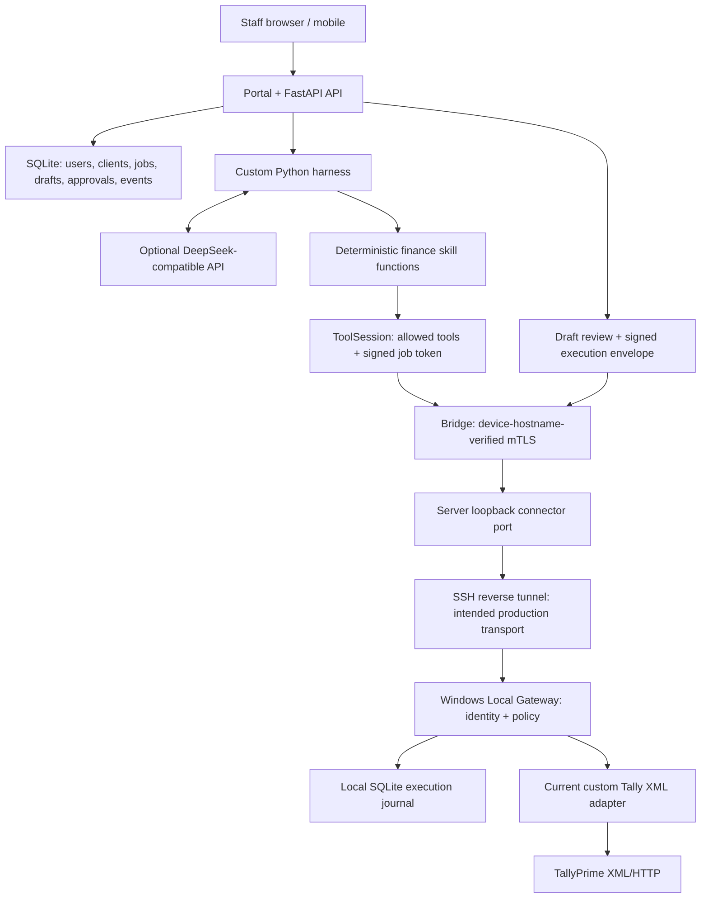
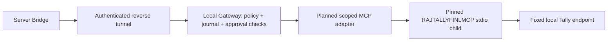
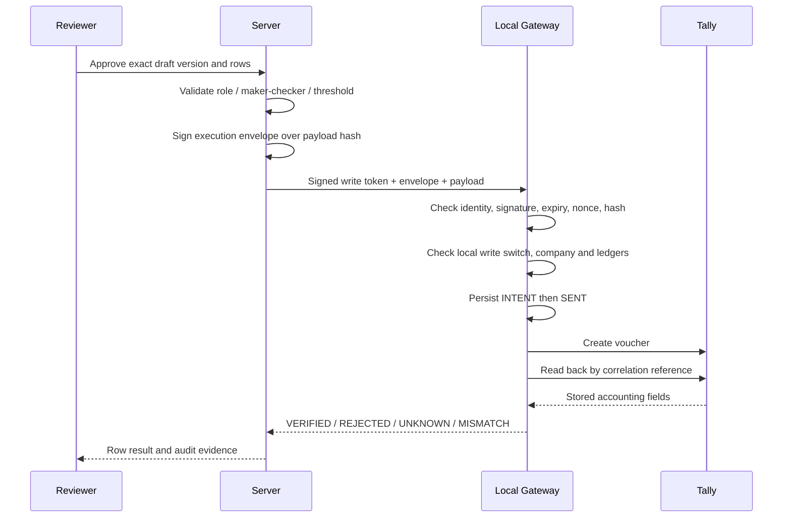

# RAJ Finance Agent — end-to-end workflow

Updated: 2026-11-03 (India time).

## સરળ સમજ

Staff Portal માં client પસંદ કરીને કામ આપે છે. Harness યોગ્ય finance Skill પસંદ કરે છે. Server Bridge SSH tunnel મારફતે client ના Local Gateway સુધી પહોંચે છે. Gateway permissions અને company તપાસીને Tally adapter દ્વારા data વાંચે અથવા approved voucher post કરે છે. પરિણામ ફરી Portal માં આવે છે.

**હાલ અને આયોજન વચ્ચેનો ફરક:** હાલ Gateway પોતાનો `raj/tally/xml_client.py` adapter વાપરે છે. RAJTALLYFINLMCP જોડવાનું આયોજન છે; તે હજી implemented અથવા verified નથી. નીચેના diagrams માં બંને સ્પષ્ટ અલગ છે.

## 1. Current implementation

The local demo and existing end-to-end tests connect Bridge directly to Gateway over loopback mTLS, without sshd. Production SSH configuration exists but requires correction and actual tunnel testing; see [ROADMAP.md](ROADMAP.md).

The central database is SQLite. The harness and its five finance skills are implemented in Python; integration with the separate DeepSeek Harness project is not implemented. Model API calls use an OpenAI-compatible HTTP interface. This does not imply any separate harness SDK is installed.

## 2. Planned RAJTALLYFINLMCP integration

Keep the Gateway's security and recovery boundaries when adding MCP:

- Pin and test a specific RAJTALLYFINLMCP revision and its actual supported protocol/tools.
- Initialize the MCP session and map only the product-supported read/write operations.
- Fix the permitted Tally endpoint and company binding outside model control.
- Do not expose raw XML/TDL, settings changes or unrestricted write tools to the model.
- Preserve signed exact-payload approvals, local write ceiling, journal and read-back verification.
- Test the real MCP protocol path separately from the current custom REST adapter path.

The current `/tools/call` HTTP endpoint is a custom REST interface; its name and UI labels do not establish MCP compatibility. See [the product plan](PRODUCT_PLAN.md) for the target architecture.

## 3. One-time pairing

1. Firm admin creates a client and requests a single-use enrollment code.
2. The connector lists open Tally companies; the local operator confirms the permitted company.
3. The connector generates a device key/CSR locally and prepares an SSH public key.
4. The server redeems the code and chooses the certificate's device identity.
5. The connector stores its device certificate, bridge CA, signing public key, SSH host-key information and assigned tunnel port.
6. The binding records company name/GUID and books-from date.
7. Posting starts disabled and needs separate server and local enablement.

Known issue: the current implementation consumes the code before validating the CSR. Pairing retry behavior must be fixed before deployment.

## 4. Connection and trust

The client PC starts an outbound OpenSSH connection. It requests a reverse listener on the server's loopback interface, mapped to the local Gateway. The Bridge connects through that route and verifies the Gateway's device hostname through mTLS.

| Layer | Responsibility |
|---|---|
| Portal API | Signed-in user, organization, client assignment and role |
| Harness / ToolSession | Select supported skills, constrain tools and issue job context |
| SSH | Restricted network transport; no general command sessions |
| mTLS | Authenticate the server Bridge and expected device Gateway |
| Job token | Bind capability/tools to org, client, device and company |
| Execution envelope | Bind a write approval to the exact voucher payload |
| Local journal / read-back | Track attempted effects and verify what Tally stored |

A connected SSH process is not proof that Gateway, Tally and the company are ready. Keep these statuses separate. Correct the current `PermitListen none` configuration and verify allowed/denied channels before using the production route.

## 5. Read-only question

Example: “90 દિવસથી વધુ બાકી receivables બતાવો.”

1. Portal validates client access and creates a read-report job.
2. Harness selects a skill using the model or deterministic rules fallback.
3. ToolSession creates a signed read token with an allowed-tool set.
4. Bridge resolves the device route and calls Gateway over mTLS.
5. Gateway checks the token, local pause policy and company binding.
6. Current adapter reads Tally; the planned MCP adapter will occupy this boundary.
7. Decimal calculation code computes totals, ageing or running balances.
8. Portal shows report metadata, tables, totals and job activity.

The model may select tools and explain results. Financial values must remain tied to deterministic tool results. The current final-text path does not enforce this completely; unsupported model figures are a known blocker.

## 6. Bank reconciliation and draft preparation

1. Upload CSV/XLSX; persist the source and its SHA-256.
2. Preview and explicitly confirm column mapping and date format.
3. Validate running balances and parse every accepted transaction.
4. Read the selected bank ledger and relevant Tally vouchers.
5. Classify statement rows: matched, unmatched, duplicate-source or ambiguous.
6. Suggest ledgers for unmatched rows; create reviewable voucher drafts.
7. A staff edit increments the draft version and invalidates unused approvals.
8. Reviewer checks exact rows, company, date, ledger and amount.

Ambiguous matches must never be auto-accepted. Existing matching and multi-year date-range defects must be fixed; see the roadmap.

## 7. Approval and posting

Both server and local write switches are required on the normal product path. Acknowledging a request is not proof of posting. Only verified read-back establishes the stored result.

## 8. Connection loss and restart recovery

Journal intent is persisted before mutation. Unfinished INTENT/SENT records become UNKNOWN on restart and block subsequent local writes until reconciliation.

- Exactly one matching voucher: verify the accounting fields and mark VERIFIED.
- Multiple or differing vouchers: preserve uncertainty and require manual review.
- No voucher found: the current implementation marks NOT_POSTED and requires fresh approval. Absence must be validated against real Tally's timing/visibility; it is not universally proof that a delayed import cannot appear later.
- Never blindly replay an uncertain write.

Central-server recovery, delayed results and crash windows need additional tests; the local journal alone does not establish complete end-to-end crash recovery.

## 9. Pause, revoke and operations

- Local pause blocks new work; local disable-writes blocks posting.
- Server disable-writes blocks new normal-path posting requests.
- Revocation blocks server routing, invalidates unused approvals and should terminate the established SSH session.
- Reconnect must re-establish identity and reconcile unfinished effects before accepting new writes.
- Test backup/restore, certificate renewal, service restart and device offboarding.

Accounting data travels from client PC to the firm server. If the model is enabled, questions, company context and sampled report results also reach the configured provider. Do not describe this architecture as zero data egress.

## 10. Validation and next steps

Follow [ROADMAP.md](ROADMAP.md) in order: fix defects and add regression tests → add Windows/actual-SSH CI → real-Tally read comparisons → test-company posting/failure recovery → small client pilot.

Operational setup and go-live procedures remain in [OPERATIONS.md](OPERATIONS.md).
